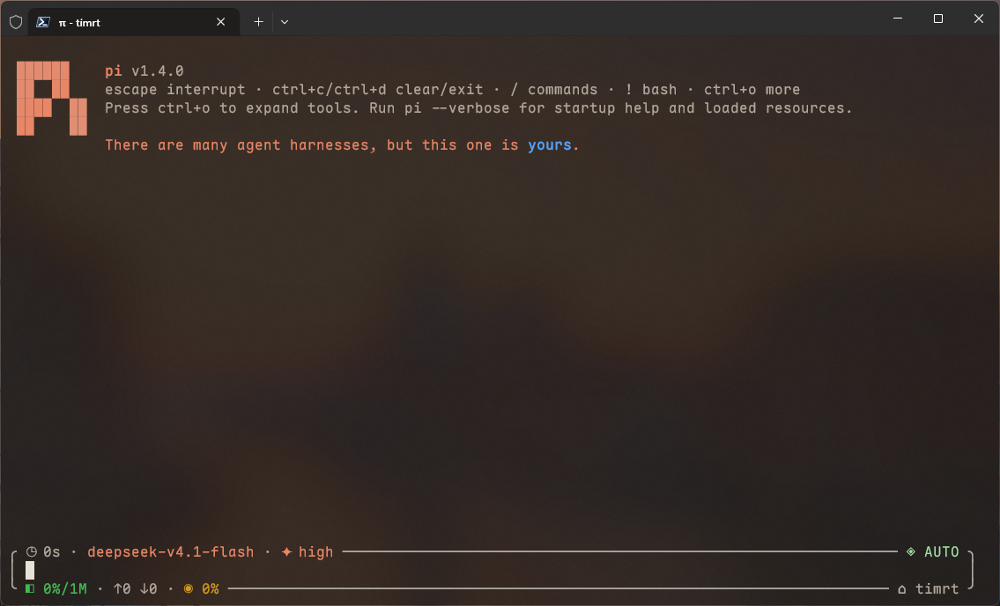

<p align="center"></p>
<h1 align="center">My Slim Pi</h1>
<p align="center">个人 Agent · Windows / PowerShell · Linux / Bash</p>

基于 Pi 的个人定制：Claude 风格终端、分级审批、免费搜索优先、Hashline 编辑，以及按需加载的记忆、技能和任务子代理。默认使用暖深色 `claude-warm` 主题，可用 `/theme` 实时预览切换。



## 安装

**无需预装 Pi。** 准备 Node.js 24+（含 npm），然后选择自己的环境：

| 系统 | 使用的终端 | 状态 |
|---|---|---|
| Windows | PowerShell 7 | 支持并验证 |
| Linux | Bash | 支持；已在 WSL2 Arch Linux 验证 |
| macOS | Bash 方案 | 尚未验证，可能需要自行适配，见下方说明 |

### Windows

在 **PowerShell 7** 运行：

```powershell
irm https://raw.githubusercontent.com/Jeoitim/my-slim-pi/main/install.ps1 | iex
```

也可以下载仓库后双击 **Install.bat**。

### Linux

下载或克隆仓库，在仓库目录运行：

```bash
bash install.sh
```

已有用户级 nvm / fnm 的 Node 24+ 时，安装器会尝试找到它，无需全局安装 Pi。

### 安装过程中会询问什么？

1. 检测已有 `pi` 的位置和版本；已有安装可选择备份修复、独立安装或取消，不会自动卸载其他 Pi。
2. 询问是否将此安装加入用户 PATH、作为默认 `pi` 命令，默认选“是”。
3. 安装固定版本、构建扩展并验证启动后，可选隐藏输入 Brave / Tavily / Exa 的搜索 Key；也可以全部跳过，插件原生 Exa 免费搜索无需 Key。

默认目录是 `~/.pi/agent`。安装完成后运行 **`pi`**；Linux 当前终端按安装器提示重新加载配置，或打开新终端。Windows 与 Linux 各自使用原生安装，WSL 不应启动 Windows 目录中的 `pi`。

<details>
<summary>macOS：未验证的 Bash 适配尝试</summary>

macOS 应走 Bash 版本的适配方向。目前安装器明确支持 Windows / Linux，遇到 macOS 会停止；不能直接视为已经兼容。可以让你的 Agent 协助适配：

> 查看 https://github.com/Jeoitim/my-slim-pi 的说明和安装脚本，帮我在 macOS 上尝试安装 Bash 方案。先检查 Node.js 和系统差异，备份已有 Pi 配置；保留权限、审批、备份和回滚机制，明确说明需要修改及尚未验证的内容，经我确认后再调整。不要执行 PowerShell 版本或把 Linux 支持当作 macOS 已验证。

</details>

## 开始使用

- **联网**：`pi-web-access@0.44.0` 原生 `web_search`、`fetch_content`、`get_search_content`；原生 auto 策略，保留全部免 Key 供应商和已有平台凭据，自动激活，保留内容缓存。
- **模型**：用 `/login` 或自己的 `models.json` 配置供应商，`/model` 选择模型。
- **关键澄清**：`pi-ask-user@0.17.0` 先调查再按需提问；AUTO / ACT 问答 90 秒未完成自动采用第一项推荐方案继续，ASK / PLAN 不自动选择。提问不代替审批或委派授权。
- **权限**：提供 AUTO / ACT / ASK / PLAN；ASK 的非只读操作逐次人工确认，PLAN 保持只读。
- **任务代理**：`/subagents` 原生管理、`/subagents-fleet` 原生 Inspector；编辑器下方 FleetView 可在空输入时按 `↓` / `←` 进入。创建任务需真实用户授权，启用后持续有效，直到明确撤销；`/task-agents` 打开开关面板（`Ctrl+Shift+A` 也可），`on|off` 仍可直接调整，后台模型设置移至 `/background-models`。
- **维护**：Windows 打开 `customization/Pi-Maintenance.bat`；Linux 运行 `bash ~/.pi/agent/customization/maintain-pi.sh Status`。

详细命令见[日常使用与维护手册](agent/customization/Pi%20Agent%20本机配置维护手册.md)。

## 更新与恢复

日常更新 Pi 本体直接运行 `pi update`。插件在实际 AgentRoot 的 `npm` 目录运行 `npm install 包名@latest --save-exact --legacy-peer-deps --ignore-scripts`，然后重启 Pi；下一次启动自动同步已配置包的版本、重建并检查，无需手动修改补丁版本门禁。插件继续精确固定，普通 `npm update` 和 `pi update --extensions` 不会跨过固定版本。真实接口不兼容时仍会停止并保留修复入口，见[升级与更新方式](docs/pi-1.4-upgrade-assessment.md)。

重新运行安装器，选择“备份后更新或修复”。已有模型、搜索 Key 和代理会保留；Web 能力设置采用本仓库已审查的原生配置，其他长期规则及个人配置保留；更新前生成配置和核心源码快照。安装失败会保留目录及备份，方便继续修复。

需要预览、自定义目录或自动化安装时，见[安装选项](docs/INSTALLATION.md)。启动损坏和恢复步骤见[维护手册](agent/customization/Pi%20Agent%20本机配置维护手册.md#备份与清理)。

## 关于此仓库

当前固定版本为 **Pi 1.4.0**，包含十个社区组件；不包含个人模型、密钥、会话或记忆数据库。具体版本见 [distribution.json](distribution.json)。

[维护仓库](docs/MAINTAINING.md) · [双平台验证报告](docs/CROSS-PLATFORM.md) · [架构审计](docs/extension-first-audit.md)
