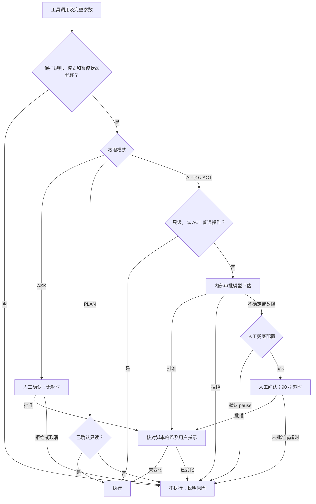
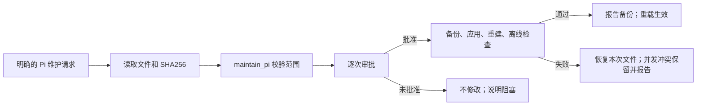

# Pi 本机维护手册

更新：2026-10-19 · Pi 1.3.0 · Node 24.20.0 · Windows / PowerShell 7
配置根目录：`~/.pi/agent`，下文文件路径均相对此目录。

**查阅顺序：** [日常操作](#日常操作) · [权限与审批](#权限与审批) · [自维护与升级](#自维护与升级) · [联网与记忆](#联网与记忆) · [备份与清理](#备份与清理) · [配置与组件](#配置与组件) · [检查与维护命令](#检查与维护命令)

## 日常操作

双击 `customization/Pi-Maintenance.bat` 打开菜单，H 查看本手册，0 退出。维护脚本优先 PowerShell 7，兼容系统 Windows PowerShell。

| 菜单 | 用途 |
|---|---|
| 1 状态与体检 | 版本、默认模型、主题、配置格式、构建与策略校验、组件及 Key 状态 |
| 2 常用设置 / 编辑配置 | 选择默认供应商、模型、主题，或备份后编辑配置 |
| 3 搜索 API Key | 隐藏输入 Brave、Tavily、Exa Key |
| 4 备份配置 | 建立配置快照，默认不含凭据 |
| 5 备份管理 | 恢复、删除全部备份、只保留最新两份 |
| 6 重建扩展 | 应用兼容补丁、编译并生成策略校验清单 |
| 7 检查 / 联网 / 测速 | 离线检查、免费 Exa 测试、启动测速、首轮上下文统计 |
| 8 清理生成物 | 预览日志和指定残留，确认后删除 |
| 9 启动 Pi | 选择工作目录并启动，退出后返回菜单 |

### 模型、主题与底栏

- `/model` 选择模型；新会话沿用最后一次手动选择，恢复旧会话使用该会话模型。项目设置和启动参数可覆盖全局默认。
- `/effort` 调节思考程度；Shift+Tab 或 Ctrl+Alt+E 循环切换。可选级别以当前模型配置为准。
- `/theme` 筛选并实时预览主题，回车保存，Esc 取消；支持 `/theme github-light`。宽终端左右排列，窄终端上下排列。
- `/subagents`（别名 `/subagent`）设置审批、Hermes 模型及任务代理。后台模型默认跟随当前会话，也可分别覆盖；打开设置不授予任务委派权限。
- 底栏显示模型实际 `name`、思考程度、权限、上下文、输入/输出和缓存命中率；宽度足够时显示费用、速度、分支与目录。未配置单价时隐藏费用；后台审批与 Hermes 消耗不计入主会话底栏。

### 排队、旁聊与提醒

| 操作 | 快捷键 / 命令 |
|---|---|
| 运行中引导下一次回复 | Enter；当前回复及工具调用完成后生效 |
| 当前任务结束后处理 | Ctrl+Alt+Enter |
| 取回队列消息 / 中止任务 | Alt+Q / Esc |
| 独立旁聊 | `/btw 问题`；主任务继续运行 |
| 旁聊设置与恢复 | `/btw`，可选上下文、模型、思考和布局 |
| 将旁聊内容带回编辑器 | Ctrl+R，手动选择；不自动发送 |
| 退出旁聊 | Ctrl+C |
| 测试终端提醒 | `/notify-test` |

旁聊默认位于右侧，分隔线可拖动；不调用工具，使用独立模型请求。旁聊只在本进程保存，重载或切换会话后清除。`/tree` 管理主会话历史分支。

人工审批每次等待发送一次终端 BEL。Windows Terminal 的 `profiles.defaults.bellStyle: "all"` 控制响铃与任务栏闪烁；Pi 不抢焦点。普通设置窗口不响铃。

## 权限与审批

`/approval-mode` 或 Ctrl+Q 切换模式。当前机制属于应用层防误操作，不是操作系统沙箱。

| 模式 | 已确认只读 | 普通写入 / 执行 | 风险删除及需核对范围的执行 |
|---|---|---|---|
| AUTO（绿） | 直接执行 | 内部审批 | 逐次内部审批 |
| ACT（黄） | 直接执行 | 直接执行 | 逐次内部审批 |
| ASK（蓝） | 逐次人工确认 | 逐次人工确认 | 逐次人工确认 |
| PLAN（紫） | 直接执行 | 不执行 | 不执行 |

**ASK 无等待超时**，仅明确批准后执行当前调用；无交互界面则不执行。纯权限诊断 `explain_call` 不额外询问，memory/MCP 封装在实际内部操作处确认。

**AUTO/ACT 默认无人值守**：审批拒绝、不确定或故障时暂停待审操作并提醒。`extensions/pi-permission-suite/config.json` 的 `reviewer.humanFallback` 默认为 `pause`；设为 `ask` 可启用人工兜底。AUTO/ACT 的审批与任务代理授权窗口 **90 秒无回应即关闭**，本次不执行，在回答中说明阻塞并等待下一轮指示。主题、模型等主动打开的设置窗口不计时。

### 命令审批路线

此图用于普通调用；`maintain_pi` 的独立流程见下一节。



### 删除、暂停与保护基线

批量、递归、通配符或跨目录删除先核对并展示精确路径、范围与影响，再审批当前调用。脚本、MCP 和任务代理遵循同样规则；删除不复用历史批准。脚本在审批期间变化，或出现新用户指示，旧批准失效。

清理脚本准备或删除审批拒绝、取消、超时或未完成后，本轮修改、执行和委派暂停，只读核对仍可继续；新用户指示允许重新评估。回答应写明未执行事项、阻塞原因和所需授权，不改成内联、拆批、换工具或代理重试。一次性删除脚本可把成功后清除自身纳入同次授权，常用脚本保留。

明确识别到的磁盘根目录、用户主目录、重要数据目录或仓库根清空，以及格式化操作硬拒绝。权限配置与整合源码受到路径保护，普通工具不能直接改写。策略 SHA256 校验失败时降级为基础只读；通过维护入口核对并重建，再重载接纳新基线。状态体检应显示 `policyIntegrity.ok: true`。

### 审批实现要点

- 审批模型通过宿主接口在当前进程运行，取得原始调用、完整参数、用户请求及可读脚本源码/哈希。静态分析用于确认只读和提取证据；复杂语法、变量或内联不直接等于人工审批。
- 首轮预算 30 秒，失败或无效结果最多再试一次、预算 20 秒；连续失败进入 60 秒故障窗口。结果要求真实 boolean 和有限数值置信度。
- 相同非删除调用的成功结论最多缓存 2 分钟，绑定目录、模型、规则及完整证据；ASK 和删除不缓存批准。
- 每轮权限摘要包含执行范围、审批路径、实际模型及当前状态。`explain_call({tool,args})` 按需查询路线，不执行、不授权，无需每次调用前预检。

## 自维护与升级

### 技能与授权

非问候对话固定提供简短的 `principal` 工程索引和 `pi-maintenance` 维护技能描述；执行模型自行决定何时读取完整技能。普通开发在当前会话完成；只有用户明确要求子代理，或同意技能提出的委派申请后，才运行任务代理。内部审批与 Hermes 复盘是已允许的后台组件。

可以直接说“维护 Pi 的主题配置”，或使用 `/skill:pi-maintenance` 读取操作指南。**读取技能不等于授权修改**；`maintain_pi` 只接受当前真实用户明确提出的 Pi 维护请求，权限相关修改还须明确提出 Pi 权限或审批维护。不能为通过其他任务的拒绝而改规则。

| 修改目标 | 方式 |
|---|---|
| 普通配置、主题、UI/搜索/记忆整合源码、两个本地技能、手册 | `maintain_pi` 受控事务 |
| APPEND_SYSTEM、approver 提示词、权限配置 JSON | 明确的权限维护请求 + 受控事务 |
| 授权/审批/事务/校验内核、主加载入口、构建器、组件加载清单、信任文件 | 外部维护入口 |
| 凭据 | 菜单 3 或本机私密配置；不通过维护补丁提交 |

### 受控事务

先读取目标文件及 SHA256，提交相对 `path`、原件 `sha256` 和完整 `content`；新文件哈希为 null。每次 1～8 个文件、合计不超过 128 KB。工具不接受删除或任意命令，拒绝越界、链接、重复目标及旧哈希。



AUTO/ACT 均须内部审批，ASK 人工确认且无超时，PLAN/清理暂停不执行。事务已包含备份与验证，无需重复运行；完成后 `/reload` 或重启。维护期间授权或构建内核变化则停止执行。

### 外部维护与组件升级

1. 在 agent 根目录运行 `pwsh -NoProfile -File customization/Maintain-Pi.ps1 -Action Backup`。
2. 核对具体补丁或组件版本。包管理使用 `pi list`、`pi install npm:包名@明确版本`；保留包资源过滤和单一扩展入口。
3. 应用后依次运行 `-Action Rebuild`、`-Action Check`。重建会应用兼容补丁、编译并生成 `customization/runtime/policy-seal.json`。
4. `/reload` 或重启，检查状态和实际行为；验证后再清理旧版与快照。构建失败先定位原因，保留回退资料。

## 联网与记忆

### 搜索

模型使用一个 `web` 入口，先懒连接免费 Exa MCP，再按查询逐个尝试 API；成功即停，主动取消则停止全部回退。

| 查询 | API 回退顺序 |
|---|---|
| 普通、时效、站点、官方文档 | Brave → Tavily basic → Exa API |
| 比较、调研、综述 | Tavily basic → Brave → Exa API |
| 论文、语义、相似页面 | Exa API → Tavily basic → Brave |
| 读取 1～3 个网页正文 | Exa MCP → Tavily basic extract → Exa contents |

缺 Key 或能力不适用时跳过。结果是否切题由模型判断；`provider: "fallback"` 可跳过不切题的 MCP 结果，或指定 `brave`、`tavily`、`exa-api`。API 使用各自账户额度，路由不自动充值或升级；额度以账户控制台为准。

菜单 3 隐藏输入并保存到 `secrets/web-keys.json`，仅当前用户可访问。环境变量 `BRAVE_API_KEY`（兼容 `BRAVE_SEARCH_API_KEY`）、`TAVILY_API_KEY`、`EXA_API_KEY` 优先于文件。`/web-status` 查看脱敏状态。

API 优先使用 HTTP(S)_PROXY 环境变量，否则按需读取 Windows 已启用的静态代理；遵守 NO_PROXY 和代理排除列表，不执行 PAC。更改代理后重启 Pi。

### 长期记忆

Hermes 按需初始化，每 12 轮或 30 次工具调用复盘，使用最近 20 条消息；退出时不额外整理。模型通过 `memory` 按需检索或更新，只保存已确认的长期偏好、约定与经验。

常用命令：`/memory-insights`、`/memory-skills`、`/memory-preview-context`、`/memory-pin`。后台模型在 `/subagents` 中设置。

## 备份与清理

| 内容 | 默认配置快照 |
|---|---|
| 普通配置、主题、代理定义、本地扩展源码、两个本地技能、维护文档、STANDING | 包含 |
| models.json、auth.json、搜索 Key | 排除；单文件编辑备份可能包含凭据 |
| 会话、记忆数据库、安装包和依赖 | 排除，需单独备份 |

快照在 `backups/config-用途-时间-随机值`，访问权限限当前用户，清单含 SHA256。恢复会验证路径与文件完整性，先备份当前配置，再要求输入 `RESTORE`；恢复后重建并重启。维护脚本和启动器不属于恢复范围，记忆数据库应关闭 Pi 后另行备份。

菜单 5 的清理选项先展示清单，再确认：

| 选项 | 确认文字 | 范围 |
|---|---|---|
| 删除全部备份 | `DELETE ALL BACKUPS` | backups 下的备份和归档 |
| 只保留最新两份完整配置备份 | `KEEP LATEST 2` | 按创建时间保留两份，其余旧快照及归档删除；单文件快照不占名额 |

不足两份时保留全部有效快照；没有有效完整快照时先备份。菜单 8 只清理生成报告/日志及明确标记的安装、调试残留归档，输入 `DELETE` 才执行。配置快照、凭据、会话、记忆、依赖与启动缓存保留。两类清理都不自动定时执行。

## 配置与组件

### 配置位置

| 路径 | 内容 |
|---|---|
| settings.json | 默认模型、主题、固定包版本与资源过滤 |
| models.json / auth.json | 模型协议与认证；CC Switch 源记录位于 `~/.cc-switch/cc-switch.db`，两处需保持一致 |
| APPEND_SYSTEM.md / pi-hermes-memory/STANDING.md | 行为规则 / 长期固定偏好 |
| agents/approver.md / extensions/pi-permission-suite/config.json | 审批提示词与可选模型 / 路径规则与人工兜底配置 |
| hermes-memory-config.json / extensions/subagent/config.json | 记忆策略 / 任务代理设置 |
| mcp.json / mcp-adapter.json | MCP 来源、懒加载与工具暴露 |
| pi-cc-extensions.json / pi-btw.json / keybindings.json | 消息渲染 / 旁聊 / 快捷键 |
| themes/ / skills/ / extensions/timrt-suite/ | 本地主题 / 技能 / 整合源码 |
| customization/runtime/ | 构建、兼容补丁、配置接口、编译清单与构建依赖 |
| customization/checks/ / customization/reports/last-check.log | 检查程序 / 最新检查日志 |

项目规则从盘符根目录逐级继承到工作目录，同目录优先 `AGENTS.override.md` → `AGENTS.md` → `CLAUDE.md`。项目 `.pi/settings.json` 可覆盖全局工具和配置。

### 当前组件

| 组件 | 固定版本 | 职责 |
|---|---|---|
| pi-cc-extensions | 1.0.5 | Claude 风格消息、diff、启动页 |
| pi-hermes-memory | 0.9.10 | 长期记忆、复盘与经验技能 |
| pi-hashline-edit-pro | 6.4.6 | 锚点读取、编辑、过期检测与撤销 |
| pi-mcp-adapter | 5.3.1 | MCP 懒连接与工具声明按需加载 |
| pi-permission-suite | 0.2.3 | 权限规则与内部审批 |
| pi-subagents | 0.78.0 | 授权后的任务子代理 |
| principal-pi-skills | 4.14.0 | 单个索引下的 9 项工程技能 |
| @anishthite/pi-themes | 0.1.9 | Ayu、Catppuccin、GitHub 等主题 |
| @narumitw/pi-btw | 0.61.2 | 独立旁聊 |

本地 `timrt-suite` 整合界面、权限、联网与维护。启动器 `bin/pi-launcher.js` 使用 Windows Node 原生运行 Pi，命令工具使用 PowerShell。五个编译入口随启动加载，第六个任务代理入口授权后加载。包的 `extensions: []` 可与预编译入口配套；每个组件只启用一个入口，MCP 由 adapter 提供。

`cache/node-compile`、`cache/jiti` 和 MCP 编译分块日常保留。启动器依据 `customization/runtime/compiled-extensions.json` 检测源码、SDK 和输出变化，必要时自动重建。

## 检查与维护命令

在 `customization` 目录运行；以下检查不调用真实模型：

```powershell
.\Maintain-Pi.ps1 -Action Status     # 脱敏状态
.\Maintain-Pi.ps1 -Action Backup     # 配置快照
.\Maintain-Pi.ps1 -Action Rebuild    # 重建及策略清单
.\Maintain-Pi.ps1 -Action Check      # 完整离线检查
.\Maintain-Pi.ps1 -Action WebTest    # 免费 Exa MCP 联网
.\Maintain-Pi.ps1 -Action Benchmark  # 三次实际启动器到就绪耗时
.\Maintain-Pi.ps1 -Action Context    # 离线首轮上下文字符数
.\Maintain-Pi.ps1 -Action Clean      # 仅预览生成物清理
```

启动测速不清空系统缓存、不计终端绘制或模型首字时间；上下文字符数不等于 token，实际用量以模型返回值为准。Check 使用模拟审批和搜索响应，并验证真实 SDK 组件加载；日志每次覆盖 `reports/last-check.log`。单独的真实 API 探测会消耗账户额度，常规维护无需运行。

恢复和备份清理默认只预览；加 `-Apply` 后仍须输入指定确认文字：

```powershell
.\Maintain-Pi.ps1 -Action Restore -BackupPath '完整快照路径'
.\Maintain-Pi.ps1 -Action PruneBackups -BackupMode All
.\Maintain-Pi.ps1 -Action PruneBackups -BackupMode KeepLatestTwo
```
