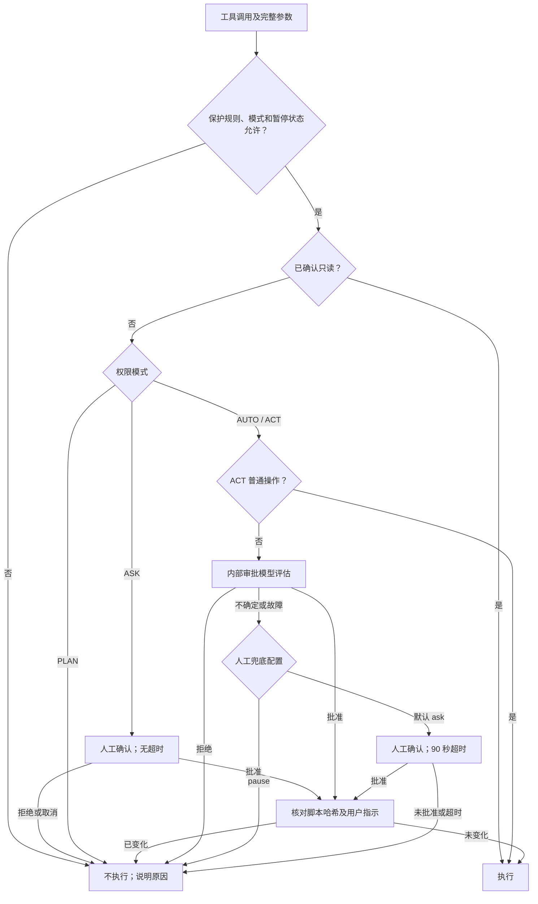
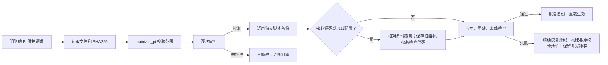

# Pi 本机维护手册

更新：2026-10-20 · Pi 1.3.0 · Node 24+ · Windows / PowerShell 7 · Linux / Bash

本安装目录自带锁定版本的 Pi，无需全局安装。Windows 使用 PowerShell 7，Linux 使用 Bash，均需要 Node.js 24+（含 npm）。

**查阅：** [入口与命令](#维护入口与命令) · [日常操作](#日常操作) · [权限与审批](#权限与审批) · [自维护与升级](#自维护与升级) · [联网与记忆](#联网与记忆) · [备份与清理](#备份与清理) · [配置与组件](#配置与组件)

## 维护入口与命令

### 先找对安装目录

下文称配置根目录为 **AgentRoot**。两套安装各用自己的配置、依赖和备份；WSL 不应执行 Windows 目录里的 Pi。自定义安装以实际目录为准；设置了 `PI_CODING_AGENT_DIR` 时先核对它是否指向当前系统的安装。

| 文件 / 入口 | Windows / PowerShell 7 | Linux / Bash |
|---|---|---|
| 默认 AgentRoot | `C:\Users\<用户名>\.pi\agent` | `/home/<用户名>/.pi/agent`，即 `$HOME/.pi/agent` |
| 启动 Pi（相对 AgentRoot） | `bin/pi.cmd` 或 `bin/pi.ps1` | `bin/pi` |
| 维护入口（相对 AgentRoot） | `customization/Maintain-Pi.ps1`；双击同目录 `Pi-Maintenance.bat` 可打开菜单 | `customization/maintain-pi.sh`，使用下表命令 |
| 生效的长期规则 | `APPEND_SYSTEM.windows.md` → `APPEND_SYSTEM.md` | `APPEND_SYSTEM.linux.md` → `APPEND_SYSTEM.md` |
| Node 定位 | 使用当前环境中的 Node 24+ | 从 `install/node-path` 读取安装时记录的原生 Node，失效时尝试 PATH |

除此表外，后文文件路径均相对当前 AgentRoot。两端共用相同的目录结构：配置在根目录，宿主在 `install/releases/<版本>/`，维护核心在 `customization/runtime/`，快照在 `backups/`，检查日志在 `customization/reports/last-check.log`。

### 常用命令放在这里

先在对应终端设置入口；自定义安装只需改第一行。之后可从任意工作目录执行，不必切换目录。

Windows / PowerShell 7：

```powershell
$agent = Join-Path $HOME '.pi/agent'
$maint = Join-Path $agent 'customization/Maintain-Pi.ps1'
& $maint                         # 打开菜单；H 查看手册，0 退出
```

Linux / Bash：

```bash
agent="$HOME/.pi/agent"
maint="$agent/customization/maintain-pi.sh"
bash "$maint" Status
```

| 要做什么 | Windows 命令 | Linux 命令 |
|---|---|---|
| 查看脱敏状态 | `& $maint -Action Status` | `bash "$maint" Status` |
| 备份配置（默认不含凭据） | `& $maint -Action Backup` | `bash "$maint" Backup` |
| 重建扩展与保护基线 | `& $maint -Action Rebuild` | `bash "$maint" Rebuild` |
| 离线就绪检查 | `& $maint -Action Check` | `bash "$maint" Check` |
| 免费 Exa 联网测试 | `& $maint -Action WebTest` | `bash "$maint" WebTest` |
| 启动测速 / 首轮上下文统计 | `& $maint -Action Benchmark` / `Context` | `bash "$maint" Benchmark` / `Context` |
| 隐藏输入搜索 Key | `& $maint -Action SetKey -KeyProvider brave` | `bash "$maint" SetKey brave` |
| 预览恢复 | `& $maint -Action Restore -BackupPath '快照绝对路径'` | `bash "$maint" Restore --backup-path '快照绝对路径'` |
| 预览备份清理 | `& $maint -Action PruneBackups -BackupMode KeepLatestTwo` | `bash "$maint" PruneBackups --backup-mode KeepLatestTwo` |
| 预览生成物清理 | `& $maint -Action Clean` | `bash "$maint" Clean` |

恢复和清理默认只预览。核对范围后，Windows 追加 `-Apply`，Linux 追加 `--apply`，仍须输入确认文字，见[备份与清理](#备份与清理)。备份清理模式也可选 `All`。Key 的供应商可选 `brave`、`tavily`、`exa`，密钥不要放进命令参数或聊天。

模型和主题优先在 Pi 内使用 `/model`、`/theme`。Windows 菜单 2 可设置模型、主题并编辑配置；Linux 对应操作为：

```bash
bash "$maint" Catalog                         # 查看供应商、模型和主题
bash "$maint" Set-Model provider model-id
bash "$maint" Set-Theme claude-warm
bash "$maint" EditConfig settings.json        # 先备份，再打开编辑器
```

`EditConfig` 使用 VISUAL / EDITOR 指定的编辑器可执行文件。共享核心 `customization/runtime/maintenance.mjs` 也支持上述 Linux 动作和参数，可由 Node 24+ 直接运行；日常维护优先使用本系统入口，Linux 无需先激活 nvm。

`Check` 使用模拟审批和搜索响应并验证真实 SDK 组件加载，不调用真实模型，日志每次覆盖。`Benchmark` 禁用 MCP 网络连接，测三次启动器到就绪耗时，不计终端绘制和模型首字时间；`Context` 是离线上下文字符数，不等于 token，也不含在线 MCP 状态。正常部署仅检查启动时，可用 Node 24+ 运行 `<AgentRoot>/customization/checks/check-startup.mjs`；完整安装测试应使用独立目录，不拿个人数据当测试夹具。

## 日常操作

安装器会询问是否将本次安装设为默认 `pi` 命令，并可选隐藏输入搜索 Key。已有安装先备份再修复，保留模型、认证、长期规则与个人配置。

若新终端仍找到旧命令，Windows 用 `Get-Command pi -All`、Bash 用 `type -a pi` 核对。当前 Bash 可 `source ~/.bashrc` 后 `hash -r`；zsh 可 `source ~/.zshrc` 后 `rehash`。安装器不移除个人别名或函数。Linux 的 `install/node-path` 不应跨系统复制。macOS 尚未验证，可尝试 Bash 安装并按环境调整，不能视为已支持。

### 模型、主题与底栏

- `/model` 选择模型；新会话沿用最后一次手动选择，恢复旧会话使用该会话模型。项目设置和启动参数可覆盖全局默认。
- `/effort` 调节思考程度；Shift+Tab 或 Ctrl+Alt+E 循环切换。可选级别以当前模型配置为准。
- 默认主题为 `claude-warm`（橙色强调色、暖深色背景）。`/theme` 筛选并实时预览主题，回车保存，Esc 取消；支持 `/theme github-light`。宽终端左右排列，窄终端上下排列。
- `/background-models` 设置权限审批与 Hermes 总结模型，默认跟随当前会话，也可分别覆盖。
- `/subagents` 直接打开上游原版子代理管理界面；`/subagents-fleet` 打开原生 Fleet Inspector，查看运行中及最近完成的代理、对话与工具记录，也可管理已有任务。
- 原生 FleetView 在编辑器下方显示活跃任务。编辑器为空且有任务条目时，按 `↓` 或 `←` 进入代理列表；继续选择条目并回车打开 Inspector，Esc 返回。没有条目时上游会收起视图。
- `/task-agents on|off` 由用户直接启用或撤销持续委派授权，空参数查看状态。授权保存在当前安装目录，跨轮次、换任务和重启保留；启用后可自主决定新增代理、类型和数量。打开管理界面或激活工具声明本身不授权。
- `/runtime-status` 查看本会话加载的构建编号、加载时间、源码更新时间和重载需求。源码待重建或新构建尚未重载时，底栏显示 `↻ /reload`，权限摘要给出当前状态。
- 底栏显示模型实际 `name`、思考程度、权限、上下文、输入/输出和缓存命中率；宽度足够时显示费用、速度、分支与目录。未配置单价时隐藏费用；后台审批与 Hermes 消耗不计入主会话底栏。

### 排队、旁聊与提醒

| 操作 | 快捷键 / 命令 |
|---|---|
| 运行中引导下一次回复 | Enter；当前回复及工具调用完成后生效 |
| 当前任务结束后处理 | Ctrl+Alt+Enter |
| 取回队列消息 / 中止任务 | Alt+Q / Esc |
| 独立旁聊 | `/btw 问题`；主任务继续运行 |
| 旁聊设置与恢复 | `/btw`，可选上下文、模型、思考和布局 |
| 将旁聊内容带回编辑器 | Ctrl+R，手动选择；不自动发送 |
| 退出旁聊 | Ctrl+C |
| 测试终端提醒 | `/notify-test` |

旁聊默认位于右侧，分隔线可拖动；不调用工具，使用独立模型请求。旁聊只在本进程保存，重载或切换会话后清除。`/tree` 管理主会话历史分支。

人工审批每次等待发送一次终端 BEL。Windows Terminal 的 `profiles.defaults.bellStyle: "all"` 控制响铃与任务栏闪烁；Pi 不抢焦点。普通设置窗口不响铃。

## 权限与审批

`/approval-mode` 或 Ctrl+Q 切换模式。当前机制属于应用层防误操作，不是操作系统沙箱。

| 模式 | 已确认只读 | 普通写入 / 执行 | 风险删除及需核对范围的执行 |
|---|---|---|---|
| AUTO（绿） | 直接执行 | 内部审批 | 逐次内部审批 |
| ACT（黄） | 直接执行 | 直接执行 | 逐次内部审批 |
| ASK（蓝） | 直接执行 | 逐次人工确认 | 逐次人工确认 |
| PLAN（紫） | 直接执行 | 不执行 | 不执行 |

**ASK 与 AUTO 共用只读免审判断**；其余调用逐次人工确认，**无等待超时**，仅明确批准后执行当前调用；无交互界面时仅允许通过只读免审的操作。memory 在实际内部操作处检查；原生 Web 按参数判断。其他 MCP 单靠 `readOnlyHint` 不免审。

**AUTO/ACT 默认启用人工兜底**：Windows 和 Linux 各自 AgentRoot 下的 `extensions/pi-permission-suite/config.json` 中，`reviewer.humanFallback` 均默认为 `ask`；审批不确定时弹出人工确认，审批服务故障时先询问暂停还是逐条人工审批。需要无人值守、不被弹窗打断时可设为 `pause`：立即暂停待审操作并提醒，不弹框、不等待，也不自动放行。明确拒绝或硬保护不会转人工兜底放行。AUTO/ACT 的人工审批与任务代理授权窗口 **90 秒无回应即关闭**，本次不执行，在回答中说明阻塞并等待下一轮指示；ASK 模式仍无等待超时。主题、模型等主动打开的设置窗口不计时。

**关键问题澄清**：缺失信息会实质影响用户意图、技术架构或不可逆操作时，先调查现有证据，仍无法确定才调用 `ask_user`；文档、代码和测试能解决的问题自主处理。子代理先通过 `contact_supervisor` 询问 Supervisor，仅其无权决定时由其向用户升级。提问、任务交接和操作授权互不替代。

`ask_user` 每题第一项为推荐方案，界面标注“推荐”，仍支持自由回答。AUTO/ACT 每题须有推荐选项，整次问答最多等待 **90 秒**；单题未回答则采用推荐项继续，2–4 题按顺序呈现、共用同一截止时间，保留已提交回答，仅其余题目采用推荐项。自动结果标记为 `timeout-default` 工作假设，不记作用户回答，不授予操作或委派权限。ASK/PLAN 不自动选择；主动取消、新用户指示、切换会话、退出和界面故障不会变成默认回答。无交互界面时返回错误并保留问题。上游强制提问技能停用，精简行为规则随工具声明提供，不重复扩充系统提示词。

### 命令审批路线

此图用于普通调用；`maintain_pi` 的独立流程见下一节。



### 删除、暂停与保护基线

批量、递归、通配符或跨目录删除先核对并展示精确路径、范围与影响，再审批当前调用。脚本、MCP 和任务代理遵循同样规则；删除不复用历史批准。脚本在审批期间变化，或出现新用户指示，旧批准失效。

清理脚本准备或删除审批拒绝、取消、超时或未完成后，本轮修改、执行和委派暂停，只读核对仍可继续；新用户指示允许重新评估。策略硬拒绝和普通执行评估失败只拒绝当前调用，不触发整轮清理暂停。回答应写明未执行事项、阻塞原因和所需授权，不改成内联、拆批、换工具或代理重试。一次性删除脚本可把成功后清除自身纳入同次授权，常用脚本保留。

明确识别到的磁盘根目录、用户主目录、重要数据目录或仓库根清空，以及格式化操作硬拒绝。权限配置与整合源码受到路径保护，普通工具不能直接改写。策略 SHA256 校验失败时降级为基础只读；通过维护入口核对并重建，再重载接纳新基线。状态体检应显示 `policyIntegrity.ok: true`。

### 审批实现要点

- 审批模型通过宿主接口在当前进程运行，取得原始调用、完整参数、用户请求及可读脚本源码/哈希。静态分析用于确认只读和提取证据；复杂语法、变量或内联不直接等于人工审批。
- 脚本正文按需附带，单文件最多 96,000 字符、总计 192,000 字符；超过预算明确标注截断，SHA256 始终覆盖完整文件。读取文件本身不触发脚本执行审查。
- 首轮预算 30 秒，失败或无效结果最多再试一次、预算 20 秒；连续失败进入 60 秒故障窗口。结果要求真实 boolean 和有限数值置信度。
- 相同非删除调用的成功结论最多缓存 2 分钟，绑定目录、模型、规则及完整证据；ASK 和删除不缓存批准。
- 每轮权限摘要包含执行范围、审批路径、实际模型及当前状态。`explain_call({tool,args})` 按需查询路线，不执行、不授权，无需每次调用前预检。

## 自维护与升级

### 技能与授权

非问候对话固定提供简短的 `principal` 工程索引和 `pi-maintenance` 维护技能描述；执行模型自行决定何时读取完整技能。普通开发默认在当前会话完成。首次任务委派由审批器结合真实用户消息和精确调用语义核对；不做自然语言关键词或正则授权匹配，复杂度或技能文字不能授权。已读技能建议可申请人工确认。授权一旦启用便持续有效，直到用户明确撤销；后续进度查看、Supervisor 问答或换任务不会收回授权。AUTO/ACT 核对真实用户当前限制和精确委派参数；ASK 保持人工逐次确认，PLAN 不创建任务。内部审批与 Hermes 复盘是已允许的后台组件。

`contact_supervisor`、`subagent_supervisor`、`bg_wait`、代理状态与记录读取独立于创建新任务的授权；下一轮不重复“使用子代理”也能继续处理。撤销阻止新增工作，保留对既有代理的查看和问答，不自动终止已有任务。上游公开 capability-ceiling API 在未授权、PLAN、清理暂停或策略异常时禁止新代理启动，覆盖原生执行入口。委派许可不豁免子代理实际操作的权限与删除规则。自然语言撤销通过 `request_subagent(action:disable)` 语义核对并保存；新的委派调用也会检查当前真实指示中的撤销和限制。

可以直接说“维护 Pi 的主题配置”，或使用 `/skill:pi-maintenance` 读取操作指南。**读取技能不等于授权修改**；`maintain_pi` 只接受当前真实用户明确提出的 Pi 维护请求，权限相关修改还须明确提出 Pi 权限或审批维护。不能为通过其他任务的拒绝而改规则。

| 修改目标 | 方式 |
|---|---|
| 普通技能、主题、手册 | 普通文件工具，遵循当前权限模式 |
| 受保护配置、UI/搜索/记忆扩展源码 | `maintain_pi` 受控事务 |
| APPEND_SYSTEM、approver 提示词、权限配置 JSON | 明确的权限维护请求 + 受控事务 |
| 授权/审批/事务/校验内核、构建器、启动器、组件加载清单、信任文件 | 明确对应核心机制的维护请求 + 同一 `maintain_pi` 事务 |
| 凭据 | 本系统 SetKey 入口或本机私密配置；不通过维护补丁提交 |

普通技能及其脚本、参考资料和文本资源可以直接用普通文件工具写入 AgentRoot/skills/<name>/，遵循当前权限模式；不需要先授权维护权限内核，也不强制使用 maintain_pi。文件与技能内容不能授予执行权限。新增技能后 /reload，使原生加载器更新技能索引。

### 受控事务

先读取目标文件及 SHA256，提交相对 `path`、原件 `sha256` 和完整 `content`；新文件哈希为 null。每次 1～8 个文件、合计不超过 128 KB。工具不接受删除或任意命令，拒绝越界、链接、重复目标及旧哈希。工具始终可见，由修改前的审批器结合最新请求与当前分支近期真实用户输入判断精确补丁的授权范围；兼容的后续指示无需复述关键字，撤销及新任务优先，历史不是永久授权。工具声明随插件加载变化，以当前列表为准；读技能不等于授权。



AUTO/ACT 均须内部审批，ASK 人工确认且无超时，PLAN/清理暂停不执行。所有补丁均由修改前的规则审批；重大修改先调用独立维护脚本备份，并核对每个已有目标均有完整原件。核心修改使用备份中的旧维护脚本、构建器、校验器和检查代码完成本次验证，不在事务中途切换审批规则。未批准的核心变化或快照篡改使事务停止。候选代码先做语法预检；失败恢复原源码、构建产物和原校验清单，不再通过第二次重建生成不同基线。并发冲突保留并报告，未知基线仍须外部恢复。Check 执行语法、完整性和离线启动就绪检查；完整测试须在 .local 独立安装显式执行 Check --full-check。无需手动重复备份与验证；完成后底栏提示 `/reload` 或重启，新代码才进入当前会话。

修改长期规则时，当前平台源文件与 `APPEND_SYSTEM.md` 必须在同一次补丁中保持相同内容。两个平台源文件均受保护并纳入备份；修改尚未使用的平台规则也需要明确权限维护授权。

### 外部维护与组件升级

1. 使用上方本系统的 `Backup` 命令建立快照。
2. 核对具体补丁或组件版本。包管理使用 `pi list`、`pi install npm:包名@明确版本`；保留包资源过滤和单一扩展入口。
3. 应用后依次运行本系统的 `Rebuild`、`Check`。重建会应用兼容补丁、编译并生成 `customization/runtime/policy-seal.json`。
4. `/reload` 或重启，检查状态和实际行为；验证后再清理旧版与快照。构建失败先定位原因，保留回退资料。

## 联网与记忆

### 搜索

联网由固定版本 pi-web-access 0.43.0 提供，保留三个原生工具：`web_search` 搜索，`fetch_content` 读取正文，`get_search_content` 分页检索已缓存内容。搜索使用插件原生 auto 策略及串行回退，成功即停，不设置 searchRouting 或 allowedProviders 限制。仅有现行 Exa、Brave、Tavily 凭据时按原生顺序使用；原生 SearXNG、订阅账号等可改变实际优先级，不另写强制路由。未配 Exa Key 时使用插件内部的免费 Exa 服务。指定单一 provider 时遵循上游的严格选择语义。保留全部上游免 Key 入口：Exa、Parallel MCP、degoog、DuckDuckGo、Keenable，以及自建 SearXNG；OpenAI/Kimi 的订阅认证也遵循上游规则。Parallel MCP、degoog、DuckDuckGo、Keenable 在上游属于显式选择项，不擅自塞入 auto 或 all。抓取保留原生 HTTP、正文提取及原生 Fetch 回退和内容缓存；第三方托管抓取服务保持默认关闭。

`toolActivation: "auto"` 由插件按模型能力决定：支持会话中追加工具且保留提示缓存的模型先提供原生 `web_enable`，启用后追加三个工具；其他模型首轮直接声明三个工具。恢复会话沿用已有工具声明。没有统一 Web 包装工具。`/search` 查看原生缓存。

普通公开搜索和网页读取在四种模式均免审；本地路径、URL 内认证、显式 auth、代理覆盖、forceClone、视频帧及模型分析参数走实际权限流程。PLAN 拒绝，ASK 逐次人工确认，AUTO 调用内部审批，ACT 普通操作直通；凭据路径规则先于模式执行。启用 PDF 后无法在调用前判断 Content-Type，因此相关抓取整体撤销只读豁免，包括搜索的 includeContent 后台抓取。工具动态激活不改变这些规则。

默认关闭 source_check、Curator 与摘要、浏览器 Cookie、Git 克隆、GitHub 凭据读取、PDF 写入、视频和图片附加处理。PDF 默认关闭可阻止无扩展名 URL 或重定向意外落盘；需要这些能力时由用户在外部原生配置中明确启用、重建并重启，再按当前模式审批。上游参数仍可见，关闭的能力不会因参数存在而自动启用。

搜索 Key 用 SetKey（Windows 菜单 3）隐藏输入，保存到 AgentRoot/`web-search.json` 的 exaApiKey、braveApiKey、tavilyApiKey，Windows 用户 DACL，Linux 0600。配置中的显式凭据来源优先于插件的环境变量；不设置字段时使用 EXA_API_KEY、BRAVE_API_KEY、TAVILY_API_KEY。托管启动器和维护入口兼容旧 BRAVE_SEARCH_API_KEY。Key 以 ! 或 $ 开头时维护入口自动转义，避免误作命令或环境变量来源。不要在聊天、参数或共享文件中填写 Key。

代理使用同一文件的原生 `proxy`。安装时从 HTTP(S)_PROXY（兼容小写）导入；Windows 无环境配置时导入已启用的静态 HTTPS 代理，不执行 PAC。后续使用 Windows 配置菜单或 Linux `bash "$maint" EditConfig web-search.json` 调整，空字符串为直连；需要 curl，插件遵守 NO_PROXY。Key/代理修改有私密备份；能力修改还需 Rebuild 和重启。状态入口只显示 Key 是否存在。

### 长期记忆

Hermes 按需初始化，每 12 轮或 30 次工具调用复盘，使用最近 20 条消息；退出时不额外整理。模型通过 `memory` 按需检索或更新，只保存已确认的长期偏好、约定与经验。

常用命令：`/memory-insights`、`/memory-skills`、`/memory-preview-context`、`/memory-pin`。后台模型在 `/background-models` 中设置。

## 备份与清理

| 内容 | 默认配置快照 |
|---|---|
| 普通配置、主题、代理定义、本地扩展源码、技能、维护文档、STANDING、信任配置 | 包含 |
| npm 包清单与锁文件、独立维护脚本、构建/校验源码、检查脚本、启动器与 Linux Node 定位文件 | 包含；不备份生成的 seal、编译产物或依赖 |
| web-search.json（可能含搜索 Key 和认证代理） | 包含，快照须私密保管，清单标记 credentialsIncluded |
| models.json、auth.json | 排除；单文件编辑备份可能包含凭据 |
| 会话、记忆数据库、安装包和依赖 | 排除，需单独备份 |

快照在 `backups/config-用途-时间-随机值`，Windows 使用用户 DACL，Linux 目录 0700、文件 0600，清单含 SHA256。恢复先展示路径、源文件 SHA256 和当前目标状态，输入 `RESTORE` 后复查这些状态并创建安全快照；维护脚本、构建器及启动器也可恢复，恢复后重建并重启。记忆数据库应关闭 Pi 后另行备份。

如果本次核心修改导致 Pi 或现用维护入口无法启动，退出 Pi，用该次备份保存的旧入口恢复，不需要新增恢复系统：

先按上方设置当前安装的 `$agent` / `agent`，再选择该系统中包含旧维护入口的完整快照。以下先预览：

Windows / PowerShell 7：

```powershell
$backup = '完整快照绝对路径'
& "$backup/customization/Maintain-Pi.ps1" -AgentRoot $agent -Action Restore -BackupPath $backup
```

Linux / Bash：

```bash
backup='完整快照绝对路径'
bash "$backup/customization/maintain-pi.sh" --agent-root "$agent" Restore --backup-path "$backup"
```

确认清单后，Windows 追加 `-Apply`、Linux 追加 `--apply`，并输入 `RESTORE`。这里运行的是快照中的旧入口；Linux 同时使用快照里的 `install/node-path`。恢复后再用现用入口运行 Rebuild、Check 并重启。外部恢复不覆盖未列入快照的文件。

核心事务还保存 `<快照>/transaction-runner/customization/runtime/maintenance.mjs`，可用本机 Node 24+ 配合 `--agent-root <原配置目录> Restore --backup-path <快照>` 预览；确认后追加 `--apply`。仅有部分文件的备份不一定包含独立恢复入口。

仅核心事务会保存 `transaction-runner`；一般完整配置备份也包含共享维护核心，可在外部独立恢复。快照是同一用户可访问的恢复材料，不是操作系统级防篡改隔离。

PruneBackups（Windows 菜单 5）先展示清单，再确认：

| 选项 | 确认文字 | 范围 |
|---|---|---|
| 删除全部备份 | `DELETE ALL BACKUPS` | backups 下的备份和归档 |
| 只保留最新两份完整配置备份 | `KEEP LATEST 2` | 按创建时间保留两份，其余旧快照及归档删除；单文件快照不占名额 |

不足两份时保留全部有效快照；没有有效完整快照时先备份。Clean（Windows 菜单 8）只清理生成报告/日志及明确标记的安装、调试残留归档，输入 `DELETE` 才执行。配置快照、凭据、会话、记忆、依赖与启动缓存保留。两类清理都不自动定时执行。

## 配置与组件

### 配置位置

| 路径 | 内容 |
|---|---|
| settings.json | 默认模型、主题、固定包版本与资源过滤 |
| models.json / auth.json | 模型协议与认证；CC Switch 源记录位于 `~/.cc-switch/cc-switch.db`，两处需保持一致 |
| APPEND_SYSTEM.md / pi-hermes-memory/STANDING.md | 行为规则 / 长期固定偏好 |
| agents/approver.md / extensions/pi-permission-suite/config.json | 审批提示词与可选模型 / 路径规则与人工兜底配置 |
| hermes-memory-config.json / extensions/subagent/config.json | 记忆策略 / 任务代理设置 |
| web-search.json | 原生 Web 配置、私密 Key 和代理 |
| mcp.json | 用户额外 MCP 配置；默认无服务器 |
| pi-cc-extensions.json / pi-btw.json / keybindings.json | 消息渲染 / 旁聊 / 快捷键 |
| themes/ / skills/ / extensions/timrt-suite/ | 本地主题 / 技能 / 整合源码 |
| customization/runtime/ | 构建、兼容补丁、配置接口、编译清单与构建依赖 |
| customization/checks/ / customization/reports/last-check.log | 检查程序 / 最新检查日志 |

项目规则从文件系统根目录（Windows 为盘符根目录）逐级继承到工作目录，同目录优先 `AGENTS.override.md` → `AGENTS.md` → `CLAUDE.md`。项目 `.pi/settings.json` 可覆盖全局工具和配置。

### 自定义工具与按需暴露

本地整合层提供四个自定义工具，并接入关键澄清工具；组件内部工具按需加载：

| 工具 | 用途 | 何时提供给模型 |
|---|---|---|
| 原生 Web 工具 | 搜索、读取及缓存检索 | pi-web-access 自动选择启用时机 |
| `ask_user` | 先调查再澄清关键问题；AUTO/ACT 90 秒后使用推荐项继续 | 默认提供；只收集信息，不授予权限 |
| `memory` | 统一检索、保存记忆，高级 schema 按需读取 | 默认提供；隐藏底层六个记忆工具的完整声明 |
| `explain_call` | 查询某次调用的权限路线及当前运行构建状态 | 默认提供；仅诊断，不执行或授予权限 |
| `request_subagent` | 语义核对真实用户的持续委派授权或明确撤销；已读技能可建议人工确认 | 非问候时提供；申请本身不启动任务，授权直到明确撤销 |
| `maintain_pi` | 受控 Pi 配置及源码补丁事务 | 始终可见，具体维护意图与补丁逐次审批 |

Web 工具由固定版社区扩展注册，不在本地整合层增加包装或路由。MCP 管理保留宿主默认实现；默认没有搜索 MCP 服务器。工具声明数量以上方 Context 实测为准。

每轮系统提示包含**本机日期和时区**。需要实时钟点或精确日志时间范围时，Windows 在 PowerShell 执行 `Get-Date -Format o`，Linux 在 Bash 执行 `date --iso-8601=seconds`，无需额外时间工具；日常提示不持续写入变化的时分秒。

### 当前组件

| 组件 | 固定版本 | 职责 |
|---|---|---|
| pi-web-access | 0.43.0 | 原生搜索、抓取与缓存 |
| pi-ask-user | 0.17.0 | 关键问题澄清、推荐选项与自由回答 |
| pi-cc-extensions | 1.0.5 | Claude 风格消息、diff、启动页 |
| pi-hermes-memory | 0.9.10 | 长期记忆、复盘与经验技能 |
| pi-hashline-edit-pro | 6.4.6 | 锚点读取、编辑、过期检测与撤销 |
| Pi 原生 MCP | 随 Pi 1.3.0 | 原生连接、延迟发现及统一权限执行管线 |
| pi-permission-suite | 0.2.3 | 权限规则与内部审批 |
| pi-subagents | 0.78.0 | 原生管理、FleetView / Inspector 与获授权的任务委派 |
| principal-pi-skills | 4.14.0 | 单个索引下的 9 项工程技能 |
| @anishthite/pi-themes | 0.1.9 | Ayu、Catppuccin、GitHub 等主题 |
| @narumitw/pi-btw | 0.61.2 | 独立旁聊 |

本地 `timrt-suite` 整合界面、权限与维护。启动器使用本机 Node；Windows 使用 PowerShell 7，Linux 使用 Bash。四个本地预编译启动入口，suite 在启动时加载第五个任务代理产物以恢复原生管理与 Fleet；任务工具声明仍由上游 dynamic 策略按需激活，显示与执行授权分别处理。pi-web-access 直接使用上游预构建包的单一原生入口，共享宿主 SDK；不修改插件、宿主或其编译产物来实现 Web。

`cache/node-compile` 与 `cache/jiti` 日常保留。Hashline 默认数据放在当前 AgentRoot 的 `pi-hashline-edit-pro`；显式设置 PI_HASHLINE_DIR 时遵循该设置。启动器依据 `customization/runtime/compiled-extensions.json` 检测源码、SDK 和输出变化，必要时自动重建。
